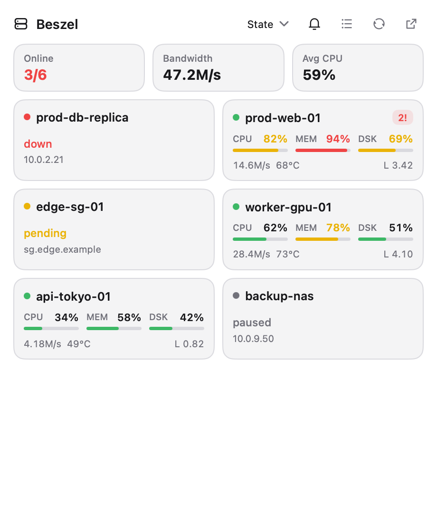
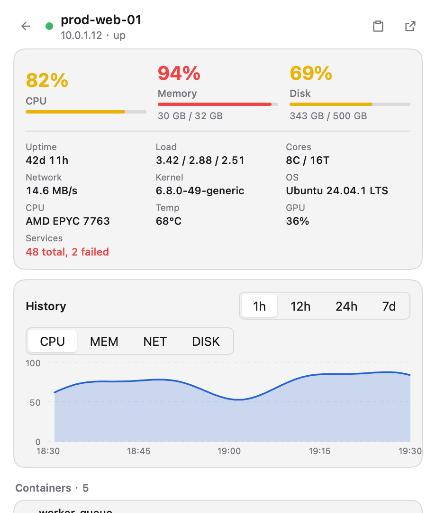
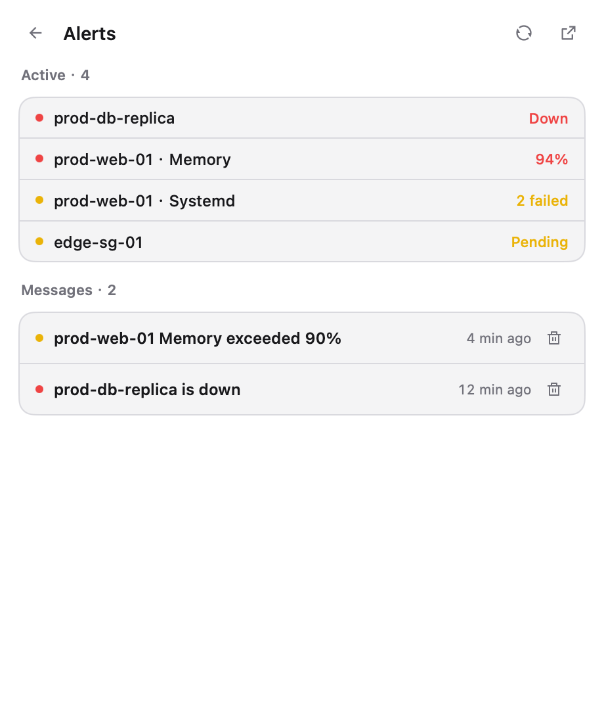

English | [简体中文](README.zh-CN.md)

# Beszel for Metrix.Bar

Keep an eye on your self-hosted [Beszel](https://beszel.dev) servers from the menu bar, screen notch, and desktop widgets in [Metrix.Bar](https://metrix.bar/) — read-only, with no extra agents or services to run.

|                                                                                                                      Overview                                                                                                                      |                                                                                                                    Server Detail                                                                                                                     |                                                                                                                 Alerts                                                                                                                  |
| :------------------------------------------------------------------------------------------------------------------------------------------------------------------------------------------------------------------------------------------------: | :--------------------------------------------------------------------------------------------------------------------------------------------------------------------------------------------------------------------------------------------------: | :-------------------------------------------------------------------------------------------------------------------------------------------------------------------------------------------------------------------------------------: |
| <picture><source media="(prefers-color-scheme: dark)" srcset="docs/overview-dark.webp" /><source media="(prefers-color-scheme: light)" srcset="docs/overview-light.webp" /></picture> | <picture><source media="(prefers-color-scheme: dark)" srcset="docs/detail-dark.webp" /><source media="(prefers-color-scheme: light)" srcset="docs/detail-light.webp" /></picture> | <picture><source media="(prefers-color-scheme: dark)" srcset="docs/alerts-dark.webp" /><source media="(prefers-color-scheme: light)" srcset="docs/alerts-light.webp" /></picture> |

## What You Can Do

- **Check cluster health at a glance**: See online count, live bandwidth, average CPU, and every server's status in a card grid or sortable table. Search filters appear automatically when you manage more than 6 servers, and wide windows expand into a split list-and-detail view.
- **Inspect any server in depth**: Open a server to view 1h / 12h / 24h / 7d CPU, memory, network, and disk I/O trends, hardware details, Docker/Podman containers, systemd services, and S.M.A.R.T. disk status. Copy a plain-text summary in one click.
- **Stay on top of alerts**: View offline servers, high-load warnings, triggered Beszel alerts, failed systemd services, and (with Metrix.Bar Plus) incoming Beszel webhook or email alert messages in one clean Alerts view. Enable desktop notifications to jump straight to the affected server.
- **Monitor from anywhere on your screen**: Customize the menu bar readout (online count, bandwidth, CPU, or macOS sparklines), glance at live stats and alert islands in the screen notch (Plus), or pin Overview, Single Server, and Alerts desktop widgets.

## Install & Connect

1. Requires **Metrix.Bar 0.3.0+**. Download [beszel.bar](dist/beszel.bar?raw=1) and import it into [Metrix.Bar](https://metrix.bar/).
2. Open the dashboard settings and enter:
   - **Server URL**: Your Beszel address (for example `https://beszel.example.com` or a LAN address like `http://10.0.0.2:8090`).
   - **Email & Password**: Your Beszel account credentials (creating a dedicated read-only user in Beszel is recommended; credentials are stored in your OS Keychain).

## Optional: Receive Beszel Alert Messages (Plus)

If you use **Metrix.Bar Plus**, you can forward Beszel notifications into a Metrix.Bar Inbox so alerts are retained even while your Mac or PC is asleep:

1. In Metrix.Bar, open **Inbox**, create an inbox with **URL secret** authentication, and copy its webhook URL (`https://agili-inbox.com/h/<inbox-id>/<secret>`).
2. Bind that inbox to your Beszel dashboard instance (enable **manage** access if you want to delete messages from the dashboard).
3. In Beszel, go to **Settings → Notifications**, add a Webhook URL, and replace `https://` with `generic://`:

```text
generic://agili-inbox.com/h/<inbox-id>/<secret>
```

> **Notes**
>
> - Shoutrrr's `generic://` scheme uses HTTPS by default. You can optionally append `?template=json` if you prefer structured JSON payloads — the dashboard parses both plain text and JSON automatically.
> - If your Beszel Hub already has SMTP configured, you can also send email notifications directly to `<inbox-id>@agili-inbox.com`.

## Settings

| Setting              | Default                 | What it controls                                                                         |
| -------------------- | ----------------------- | ---------------------------------------------------------------------------------------- |
| **Language**         | Follow Metrix.Bar       | Follow the app, English, or Simplified Chinese. Restart after changing the app language. |
| **Server URL**       | `http://127.0.0.1:8090` | Your Beszel address (local HTTP supported)                                               |
| **Email / Password** | _Required_              | Beszel login credentials (stored in OS Keychain)                                         |
| **Refresh Interval** | `30s`                   | How often data refreshes (`15s`, `30s`, `60s`)                                           |
| **Menu Bar**         | Online (`4/5`)          | Menu bar display (`Online`, `Bandwidth`, `CPU`, macOS sparklines)                        |
| **Notch Metric**     | Online (`4/5`)          | Metric shown in the screen notch (Plus)                                                  |
| **Desktop Widget**   | Overview                | Widget mode (`Overview`, `Single Server`, `Alerts`)                                      |
| **Widget Server**    | _Blank_                 | Specific server ID or name for Single Server widget                                      |
| **Notifications**    | Off                     | Desktop alerts on outage, high load, or new alert messages                               |
| **Alert Threshold**  | `90%`                   | Resource threshold for warnings (`0` disables)                                           |

## Permissions

- **Network**: Only connects to the Beszel server URL you configure.
- **Inbox (Optional, Plus)**: Only accesses inboxes you explicitly bind to this dashboard.
- **Read-only**: Never modifies Beszel servers, containers, or alert rules.

## Development

```sh
pnpm install
pnpm check
pnpm test
pnpm build
```

The build writes the importable bundle to `dist/beszel.bar`.

## License

[Apache-2.0](LICENSE).
