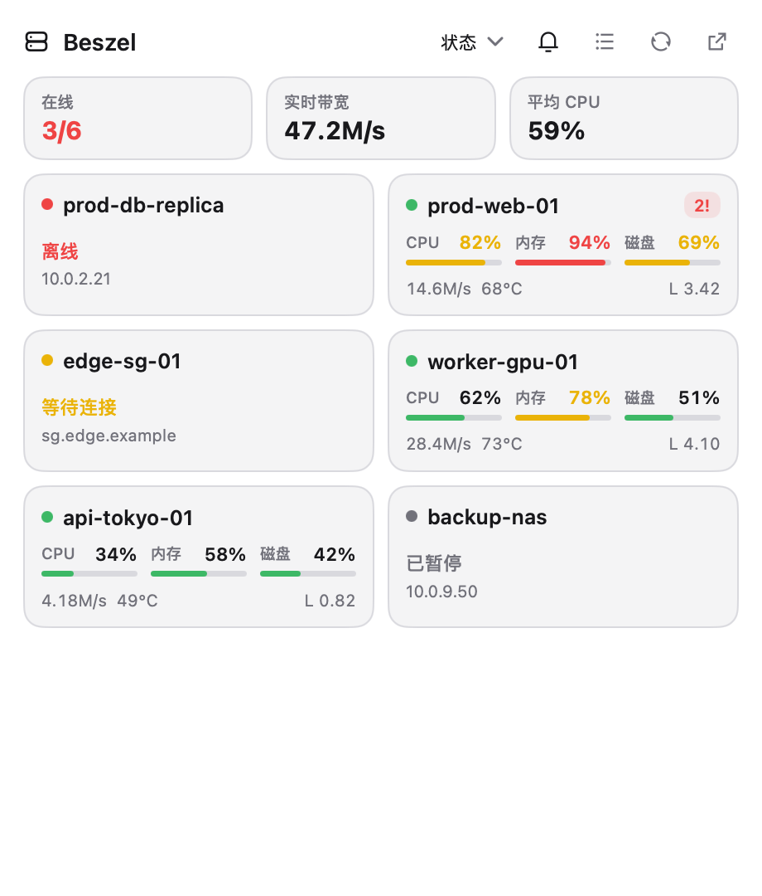
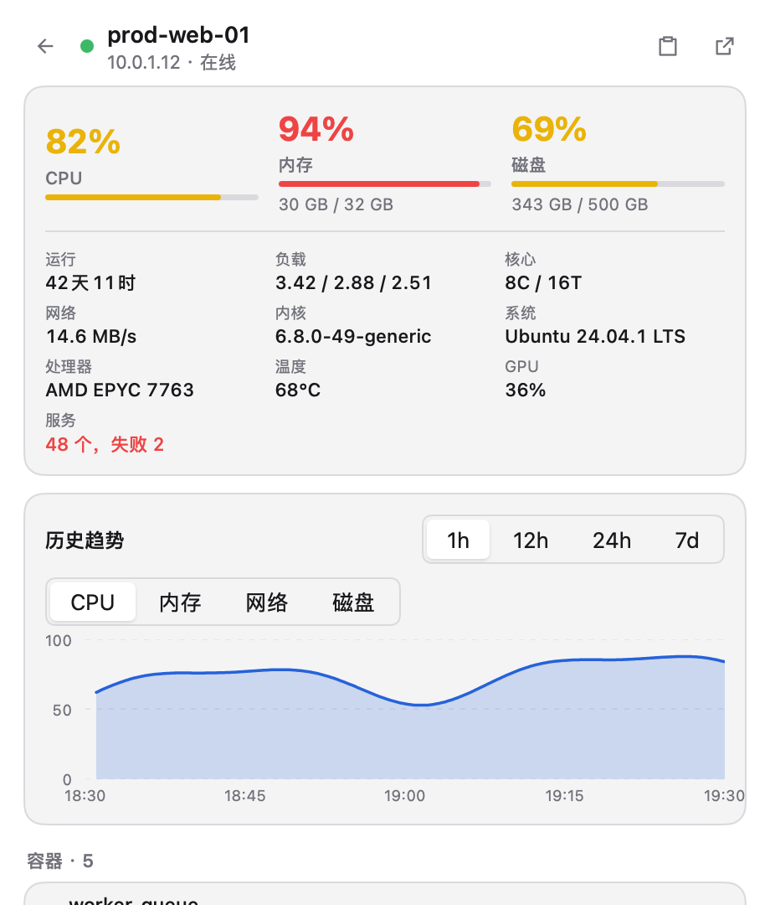
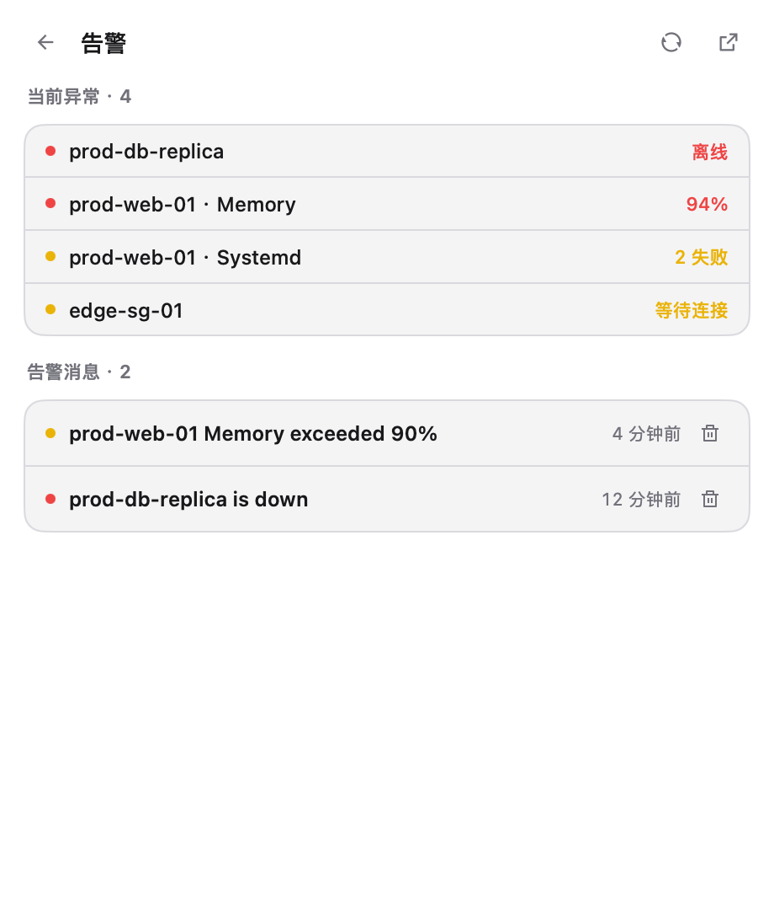

[English](README.md) | 简体中文

# Beszel 服务器监控看板

在 [Metrix.Bar](https://metrix.bar/) 的菜单栏、刘海屏与桌面小组件中，以只读方式随时掌握自建 [Beszel](https://beszel.dev) 的主机状态、容器与告警，无需额外部署任何服务。

|                                                                                                                      集群总览                                                                                                                       |                                                                                                                      主机详情                                                                                                                       |                                                                                                                    告警                                                                                                                     |
| :-------------------------------------------------------------------------------------------------------------------------------------------------------------------------------------------------------------------------------------------------: | :-------------------------------------------------------------------------------------------------------------------------------------------------------------------------------------------------------------------------------------------------: | :-----------------------------------------------------------------------------------------------------------------------------------------------------------------------------------------------------------------------------------------: |
| <picture><source media="(prefers-color-scheme: dark)" srcset="docs/overview-zh-dark.webp" /><source media="(prefers-color-scheme: light)" srcset="docs/overview-zh-light.webp" /></picture> | <picture><source media="(prefers-color-scheme: dark)" srcset="docs/detail-zh-dark.webp" /><source media="(prefers-color-scheme: light)" srcset="docs/detail-zh-light.webp" /></picture> | <picture><source media="(prefers-color-scheme: dark)" srcset="docs/alerts-zh-dark.webp" /><source media="(prefers-color-scheme: light)" srcset="docs/alerts-zh-light.webp" /></picture> |

## 可以帮你做什么

- **一眼掌握全局状态**：在固定高度的清爽面板中查看在线数、实时总带宽、平均 CPU 与每台主机的资源占用；支持卡片网格与可排序表格一键切换，超过 6 台主机自动出现搜索框，宽窗口自动展开左列表右详情双栏。
- **深入排查单机指标**：点击任意主机即可查看 1h / 12h / 24h / 7d 的 CPU、内存、网络上下行与磁盘 I/O 走势，以及硬件信息、Docker / Podman 容器健康度、systemd 服务和 S.M.A.R.T. 硬盘状态，并支持一键复制主机摘要。
- **集中处理所有告警**：在一个精简的告警页里统一查看离线主机、超阈资源、Beszel 已触发告警、失败服务，以及（Metrix.Bar Plus）通过 Webhook / 邮件送达的历史告警消息；开启桌面通知后，点击通知即可直达对应主机。
- **多形态随时可见**：可自定义菜单栏显示（在线数、带宽、CPU 或 macOS 迷你图），配合刘海屏（Plus）实时指标与异常动态岛，以及总览 / 单机 / 告警三种桌面小组件。

## 安装与连接

1. 需要 **Metrix.Bar 0.3.0+**。下载 [beszel.bar](dist/beszel.bar?raw=1) 并导入 [Metrix.Bar](https://metrix.bar/)。
2. 打开看板设置并填写：
   - **服务器地址**：你的 Beszel 地址（如 `https://beszel.example.com` 或内网地址 `http://10.0.0.2:8090`）。
   - **邮箱与密码**：Beszel 登录凭据（建议在 Beszel 中创建专用只读账号，凭据安全保存在系统钥匙串中）。

## 可选：接入 Beszel 告警推送（Plus）

如果你使用 **Metrix.Bar Plus**，可以将 Beszel 的通知推送到 Metrix.Bar 收件箱，电脑休眠期间的告警也能完整留存并随时查阅或删除：

1. 在 Metrix.Bar 主窗口打开 **收件箱**，新建一个收件箱（认证方式选 **URL 密钥**），复制它的 Webhook 地址（形如 `https://agili-inbox.com/h/<inbox-id>/<secret>`）。
2. 在 Beszel 看板设置中绑定该收件箱（勾选 **管理权限** 即可在看板内一键删除消息）。
3. 打开 Beszel 的 **设置 → 通知**，添加一条 Webhook，把地址开头的 `https://` 替换为 `generic://`：

```text
generic://agili-inbox.com/h/<inbox-id>/<secret>
```

> **提示**
>
> - Beszel 使用的 Shoutrrr `generic://` 协议默认启用 HTTPS。如需结构化 JSON 推送，也可在末尾追加 `?template=json`，看板会自动解析纯文本与 JSON 正文。
> - 如果你的 Beszel 已配置 SMTP 邮件发信，也可以直接将通知邮箱填为 `<inbox-id>@agili-inbox.com`。

## 常用设置

| 设置项          | 默认值                  | 说明                                               |
| --------------- | ----------------------- | -------------------------------------------------- |
| **语言**        | 跟随系统                | 界面语言（自动 / English / 简体中文）              |
| **服务器地址**  | `http://127.0.0.1:8090` | Beszel 地址，支持内网 HTTP                         |
| **邮箱 / 密码** | _必填_                  | Beszel 登录凭据（存入系统钥匙串）                  |
| **刷新间隔**    | `30 秒`                 | 数据刷新频率（15 秒 / 30 秒 / 60 秒）              |
| **菜单栏显示**  | 在线数 (`4/5`)          | 可选在线数、在线数与带宽、平均 CPU 或 macOS 迷你图 |
| **刘海屏指标**  | 在线数 (`4/5`)          | 刘海屏显示的数值（Plus）                           |
| **桌面小组件**  | 集群总览                | 可选集群总览、单台主机、告警                       |
| **小组件主机**  | _留空_                  | 单台主机小组件指定的主机 ID 或名称，留空跟随选中项 |
| **桌面通知**    | 关闭                    | 主机离线、超阈或收到告警消息时提醒                 |
| **告警阈值**    | `90%`                   | CPU / 内存 / 磁盘达到该百分比时提醒（0 为关闭）    |

## 权限说明

- **网络权限**：仅访问你填写的 Beszel 服务器地址。
- **收件箱权限（可选，Plus）**：仅读取与管理你明确绑定到此看板的收件箱。
- **严格只读**：不会修改 Beszel 中的任何主机、容器或告警规则。

## 开发

```sh
pnpm install
pnpm check
pnpm test
pnpm build
```

构建产物输出至 `dist/beszel.bar`。

## 许可证

[Apache-2.0](LICENSE)。
